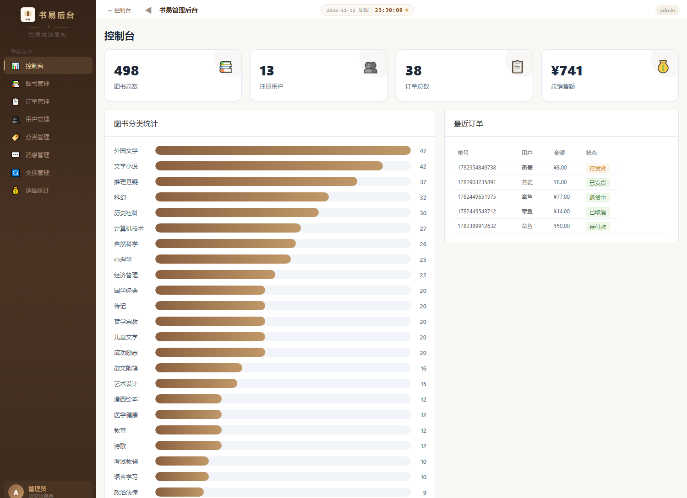
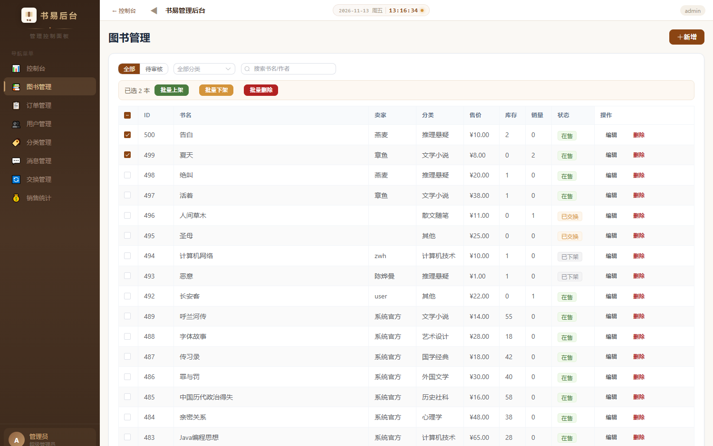
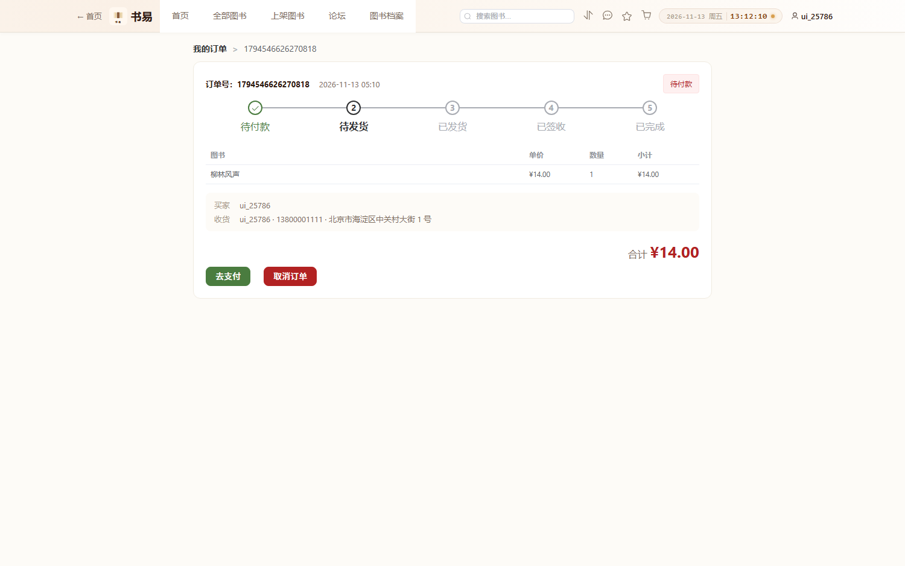
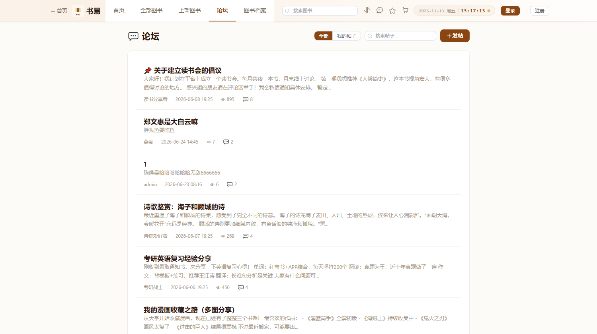
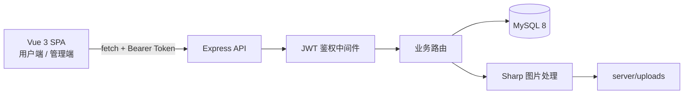

# 书易 Shuyi · 校园二手图书交易平台

一个面向校园场景的二手书交易平台：既可以按分类浏览、搜索、下单买书，也可以把自己闲置的书上架出售，还支持**以书换书**、站内私信和读书论坛。项目包含用户端与管理端，前后端分离。

> Vue 3 · Element Plus · Pinia · Express · MySQL 8 · JWT

**English** — Shuyi is a campus second-hand book marketplace (browse, sell, swap, message and forum) with a separate admin console. Vue 3 + Element Plus front end, Express + MySQL back end, JWT authentication, server-authoritative pricing and stock, and a 49-assertion API smoke test that also runs in CI.

## 界面预览

<p align="center">
  
</p>

| 首页 | 图书详情 |
|---|---|
|  |  |

| 管理端 · 控制台 | 管理端 · 图书管理 |
|---|---|
|  |  |

| 订单详情 | 论坛 |
|---|---|
|  |  |

## 功能

**用户端**

- 图书浏览、分类筛选、关键词搜索、价格 / 销量 / 上新排序（服务端分页）
- 图书详情：成色、评分与文字评价、收藏、加入购物车、立即购买
- 上架二手书：渐变封面或上传图片（前端裁剪 + 后端压缩），默认进入审核
- 我的发布 / 我的收藏 / 购物车 / 我的订单 / 订单详情
- 个人中心：修改资料、更换头像、修改密码（校验原密码）
- 订单全流程：待付款 → 待发货 → 已发货 → 已签收 → 已完成，支持取消与退货
- 卖家视角：查看「我卖出的」订单并直接发货
- 以书换书：双方各自确认后完成交换，图书归属自动互换
- 站内私信；论坛支持发帖、回复、关键词搜索、我的帖子与分页
- 图书档案：已下架 / 已交换 / 已售罄图书的归档浏览

**管理端**（`/admin`）

- 控制台：图书、用户、订单、销售额统计 + 订单状态分布
- 图书管理：审核（通过 / 驳回）、编辑、上下架、删除，支持批量上架 / 下架 / 删除
- 订单管理：发货、取消、退货审核
- 用户管理：禁用 / 启用（联动下架其在售图书）、删除
- 分类管理、消息中心、交换管理、销售统计

## 技术栈

| 层次 | 技术 |
|---|---|
| 前端 | Vue 3（`<script setup>`）、Vue Router、Pinia、Element Plus、Cropper.js |
| 构建 | Vite 8 |
| 后端 | Node.js + Express 4、mysql2 连接池、JWT、bcryptjs、Multer、Sharp |
| 数据库 | MySQL 8（InnoDB、utf8mb4），11 张表 |
| 测试 | 11 项 Vitest 集成测试 + 60 项接口冒烟脚本，GitHub Actions 自动运行 |

## 架构



- 前端只负责展示与交互，**权限判断、价格计算、库存校验全部在服务端完成**；
- 路由守卫只用于把未登录用户挡在后台页面之外，真正的校验依赖 API 返回的 401/403；
- 图片上传统一压缩成 JPEG（最长边 1200px），避免原图直出。

## 快速开始

### 1. 环境要求

- Node.js **20.19+ 或 22.12+**（Vite 8 的要求，推荐 22 LTS）
- MySQL **8.0+**，需要能用账号密码登录

### 2. 安装依赖

```bash
# 前端（项目根目录）
npm install

# 后端
cd server
npm install
```

### 3. 配置数据库

```bash
cd server
cp .env.example .env      # Windows: copy .env.example .env
```

按实际情况修改 `.env` 中的 `DB_HOST / DB_USER / DB_PASSWORD / DB_NAME`。Node 20.12+ 会自动读取该文件，无需额外安装 dotenv。

### 4. 初始化数据库

```bash
cd server
npm run init-db
```

会创建 `shuyi` 库、11 张表、23 个分类、489 本示例图书，并创建管理员账号。

> ⚠️ `init-db` 会 **DROP 并重建** 目标库中的表，只能在空库或测试库上执行。

### 5. 启动

**开发模式**（改代码即时热更新，需要两个终端）

```bash
# 终端 1：后端（3000）
cd server
npm start

# 终端 2：前端（5173）
npm run dev
```

打开 <http://localhost:5173>。

**生产模式**（单端口，一个终端即可）

```bash
npm run build      # 生成 dist/
npm run serve      # 后端同时托管前端，访问 http://localhost:3000
```

也可以 `npm run start:prod` 一步完成构建 + 启动。后端检测到 `dist/index.html` 后会自动托管静态资源，并对 `/books/1` 这类前端路由做回退。

### 6. 让手机 / 其他电脑访问

同一 Wi-Fi 下可以直接用局域网地址打开：

```powershell
ipconfig                       # 找到「IPv4 地址」，例如 192.168.1.8
# 手机浏览器打开 http://192.168.1.8:3000
```

首次需要在管理员 PowerShell 放行端口：

```powershell
netsh advfirewall firewall add rule name="Shuyi 3000" dir=in action=allow protocol=TCP localport=3000
```

汇总目录里的 `启动-局域网.bat` 会自动打印可用地址。

## 账号

| 角色 | 账号 | 密码 |
|---|---|---|
| 管理员 | `admin` | `123456` |
| 普通用户 | 自行注册 | — |

管理端入口：首页 → 管理端，或直接访问 `/admin/login`。

> 演示账号密码仅供本地体验，部署到公网前请立即修改。

## 环境变量

| 变量 | 默认值 | 说明 |
|---|---|---|
| `PORT` | `3000` | 后端端口 |
| `DB_HOST` | `localhost` | MySQL 地址 |
| `DB_PORT` | `3306` | MySQL 端口 |
| `DB_USER` | `root` | 数据库账号 |
| `DB_PASSWORD` | `root` | 数据库密码 |
| `DB_NAME` | `shuyi` | 数据库名 |
| `JWT_SECRET` | 开发用默认值 | 生产环境必须设置，否则启动会报错 |
| `BOOK_REVIEW` | `1` | 用户发布的书是否需要管理员审核 |
| `MYSQL_URL` / `DATABASE_URL` | — | 云平台数据库连接串，存在时自动解析（Railway 用 `${{MySQL.MYSQL_URL}}`） |
| `CORS_ORIGINS` | `http://localhost:5173,http://127.0.0.1:5173` | 允许跨域的前端地址，逗号分隔 |

## 目录结构

```
book-management/
├── src/                    # 前端源码
│   ├── views/              # 用户端页面
│   ├── admin/              # 管理端页面
│   ├── components/         # 公共组件
│   ├── stores/             # Pinia 状态
│   ├── api/                # 接口封装（统一注入 token、处理 401）
│   └── router/
├── server/                 # 后端源码
│   ├── routes/             # 路由：auth / books / orders / swaps / messages / forum / categories / upload / stats
│   ├── middleware/         # JWT 鉴权、限流
│   ├── test/               # Vitest 集成测试
│   ├── scripts/            # 冒烟测试、数据体检/备份/修复
│   ├── config.js           # 环境变量与配置
│   ├── init-db.js          # 建库建表 + 导入种子数据
│   └── books.json          # 489 本种子图书
├── docs/                   # 接口文档、部署指南、截图
├── Dockerfile              # 生产镜像
├── docker-compose.yml      # 应用 + MySQL 一键启动
└── vite.config.js
```

## 测试

测试分两层：

- **Vitest + Supertest 集成测试**（11 项）：直接挂载 Express app，覆盖健康检查、分页、鉴权、404、注册/登录/改密流程；
- **接口冒烟脚本**（60 项）：真实启动服务后跑完整业务流，覆盖鉴权、审核、下单计价、库存回滚、越权访问、私信、论坛、评分、交换。

```bash
cd server
npm test        # Vitest（使用 shuyi_test 库，需要先初始化）
```

冒烟脚本的用法见下方命令。

GitHub Actions 会在 MySQL 8 容器里自动执行同一套测试（见 `.github/workflows/ci.yml`）。

**macOS / Linux / Git Bash**

```bash
# 建议用独立的测试库，不要动真实数据
cd server
DB_NAME=shuyi_test npm run init-db
DB_NAME=shuyi_test PORT=3100 npm start

# 另开终端
cd server
SMOKE_BASE=http://localhost:3100 npm run smoke
```

**Windows PowerShell**

```powershell
cd server
$env:DB_NAME='shuyi_test'; npm run init-db
$env:DB_NAME='shuyi_test'; $env:PORT='3100'; npm start

# 另开终端
cd server
$env:SMOKE_BASE='http://localhost:3100'; npm run smoke
```

## 数据维护

内置三个只读/安全脚本，改数据前先备份：

```bash
cd server
npm run audit:data              # 只读体检：分类、评分缓存、销量、订单金额、关联完整性
npm run backup:db               # 逻辑备份到 shuyi_backup_时间戳 库
npm run fix:data                # 预览修复项
npm run fix:data -- --apply     # 执行修复
```

体检覆盖：图书状态/分类一致性、价格库存异常、评分缓存与明细、销量与已完成订单、订单金额与明细、收藏/明细/订单号等关联完整性、交换状态、论坛回复数、用户资料与文本编码。

## 安全设计

- 全部业务接口默认需要登录，管理接口额外校验 `role === 'admin'`；
- 下单只接收 `book_id` 与数量，价格、总价、卖家由服务端查询数据库计算；
- 库存扣减、状态流转、交换完成等操作使用数据库事务 + 行锁；
- 用户身份一律取自 token，忽略请求体里的 `user_id / seller_id`；
- 登录/注册接口带频率限制；
- CORS 白名单（`CORS_ORIGINS`）+ `nosniff` / `X-Frame-Options` 等基础安全响应头；
- 上传接口校验登录态与文件真实类型，统一重编码为 JPEG。

## 已知限制

- 文字评价暂无敏感词过滤与人工审核；
- 支付为模拟流程，未接入真实支付渠道；
- 图片存本地磁盘，未接入对象存储；
- 集成测试覆盖核心接口，业务分支与前端组件测试尚未全覆盖；
- 限流是单机内存实现，多实例部署需要换成共享存储。

## 部署

生产模式下一进程即可：`npm run build && npm run serve`（或 `npm start:prod`），访问 `http://localhost:3000`。

局域网、云服务器 + Nginx + HTTPS、Railway（推荐）、Render、Docker Compose 见 [docs/DEPLOY.md](./docs/DEPLOY.md)。仓库已带 `railway.json`、`Dockerfile`、`docker-compose.yml`、`.dockerignore`，部署平台不用手写构建命令。

## 生产环境注意事项

- 必须通过环境变量设置 `JWT_SECRET`（`NODE_ENV=production` 时缺失会拒绝启动）；
- 用 `CORS_ORIGINS` 把允许的前端地址收敛到实际域名；
- 前端构建产物交给 Nginx 等静态服务器，后端只暴露 `/api` 与 `/uploads`，并开启 HTTPS；
- 修改默认管理员密码（`admin / 123456` 仅用于本地演示）；
- 上传目录需要持久化，或把 `routes/upload.js` 换成对象存储；
- 支付是模拟流程，接入真实支付前不要上线交易功能。

## 上传到 GitHub

```bash
# 如果项目还不是 git 仓库（目录下没有 .git）
git init
git add .
git commit -m "feat: 书易校园二手书交易平台（Vue3 + Express + MySQL）"
git branch -M main

# 如果已经初始化过，直接从这一步开始
git remote add origin https://github.com/<你的用户名>/book-management.git
git push -u origin main
```

仓库已配置 `.gitignore`：`node_modules`、`dist`、`server/uploads` 里的用户图片、`.env` 都不会被提交。建议先建 Private 仓库，确认无误后再公开。

## License

[MIT](./LICENSE)
